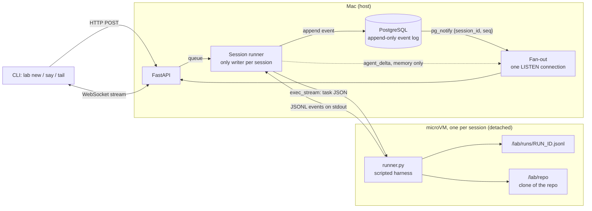
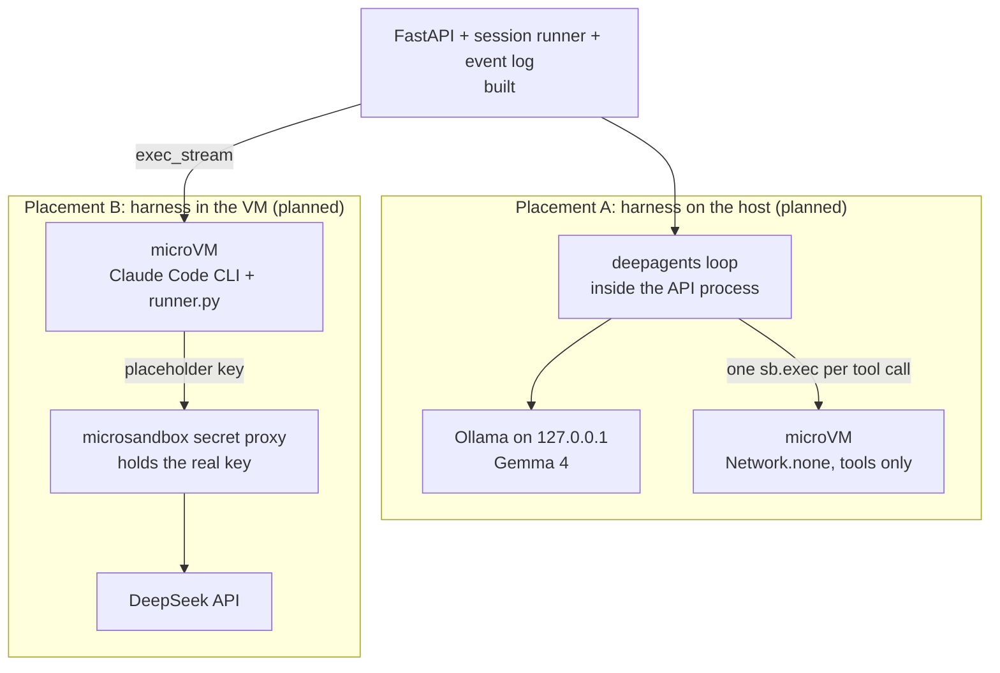

# sandboxed-agents-lab

A small lab for coding agents that run in per-chat microVMs ([microsandbox](https://github.com/superradcompany/microsandbox)), behind a session layer whose single source of truth is an append-only event log in PostgreSQL.

Work in progress. The first step was a set of spikes that check microsandbox on Apple Silicon and measure what a VM costs: see [docs/spike-results.md](docs/spike-results.md). The session layer now runs one chat end to end with a scripted (fake) agent: a session gets its own VM with a clone of the repo, the agent runs inside it, and every durable event lands in the log and streams to clients.

## Architecture

### How it works today



Each session gets its own microVM with a clone of the repo. The API hands a user message to the session's runner task, the only process allowed to write that session's events. The runner starts `runner.py` inside the VM, which writes every durable event to a file in the VM first and then prints it. The session runner appends those events to PostgreSQL, and a single `LISTEN` connection wakes the WebSocket subscribers, who read the new rows from the log. The log is the single source of truth: session state is a fold over its events. Token-by-token deltas (`agent_delta`) only go to live clients and are never stored. The VM is detached, so it keeps running if the API restarts, and the next message reattaches to it.

### Where it is going



Two real agent harnesses will sit behind the same interface, each placed where its vendor designed it to run. In A, the deepagents loop runs on the host with a local model, and only its tool calls run in a VM that has no network. In B, the Claude Code CLI runs inside the VM. It uses DeepSeek through its Anthropic-compatible API, and the VM never sees the API key: microsandbox's proxy swaps a placeholder for the real key on requests to the DeepSeek host only. The spikes checked the pieces both rely on: a VM with no network, the per-call `exec` cost, and the secret proxy with the CLI ([docs/spike-results.md](docs/spike-results.md)).

## Requirements

- Apple Silicon Mac, [uv](https://docs.astral.sh/uv/)
- Python 3.13 (`uv python install 3.13`)
- Docker (for example OrbStack) to run PostgreSQL 18 from `compose.yaml`
- For the network spike: `DEEPSEEK_API_KEY` in the environment
- If the Mac runs an outbound firewall (for example LuLu), allow `.venv/lib/python3.13/site-packages/microsandbox/_bundled/bin/msb`. All guest traffic leaves through that binary.

Docker is only used for Postgres. `uv sync` installs the microsandbox Python SDK, and its wheel bundles the runtime (`msb` plus libkrun), which runs each VM on macOS Hypervisor.framework. No daemon is involved: the API process owns the VMs.

## Commands

```sh
uv sync                # create .venv and install the pinned dependencies from uv.lock
make db-up             # start PostgreSQL (compose.yaml, host port 55432)
make migrate           # apply migrations/*.sql
make api               # run the session API on http://127.0.0.1:8000
make lint              # ruff (lint and format check) and mypy
make test              # unit tests (need Postgres, use their own lab_test database)
make test-integration  # end-to-end tests with real microVMs (need network)
make spike             # run the three spikes in order
make check-names       # fail if a tracked file matches a pattern in the local .names-denylist
```

A chat from the command line, with `make api` running in another terminal:

```sh
uv run lab new https://github.com/pallets/markupsafe   # prints the session id
uv run lab tail <session_id>                           # stream events (Ctrl-C to stop)
uv run lab say <session_id> "Do the tests pass?"       # in a third terminal
```

The API: `POST /sessions {repo_url, harness}`, `POST /sessions/{id}/messages {text, idem_key}` (202), `GET /sessions/{id}/events?after=N`, and `WS /sessions/{id}/stream?after=N`. Only `scripted` exists as a harness so far.

## Project structure

| Path | What it is |
|---|---|
| `pyproject.toml`, `uv.lock`, `.python-version` | Python 3.13 project; dependencies pinned by uv |
| `Makefile` | The commands above |
| `compose.yaml` | PostgreSQL 18 for the event log |
| `migrations/` | SQL migrations, applied in file name order by `make migrate` |
| `src/lab/` | The lab package: event store (`events.py`), live fan-out (`fanout.py`), sandbox manager (`sandbox.py`), per-session runner task (`session.py`), API (`api.py`), CLI (`cli.py`) |
| `src/lab/harnesses/` | Agent harnesses behind one interface, plus the registry |
| `src/lab/runner/runner.py` | Copied into each VM; runs the in-VM agent, JSON task in, JSONL events out |
| `tests/` | Unit tests; `tests/integration/` runs real microVMs |
| `spikes/` | Throwaway experiments that answer one question each before the real code is written |
| `spikes/out/` | Raw spike output (JSON and cached downloads). Gitignored |
| `docs/spike-results.md` | Curated spike numbers and the decisions they drove |
| `scripts/check_names.sh` | Name check used by `make check-names` |
| `.names-denylist` | Local regex list for the name check. Gitignored, never committed |
| `~/.microsandbox/` | Outside the repo: microsandbox's image cache, sandbox database and CA. Created by the SDK |

## Spikes

A spike is a short, disposable experiment that removes a risk before building on it. Each script prints its measurements and writes `spikes/out/<spike>.json`. Every VM it starts is destroyed at the end.

| Script | Question it answers | What it does |
|---|---|---|
| `sandbox_spike.py` | Does microsandbox work on this Mac, and what does a VM cost? | Times cold and warm create, boot to first exec, the `exec` round trip and `fork`; measures memory with 1, 3 and 5 VMs at 512 MiB and 1 GiB; clones a small public repo in a VM and runs its tests |
| `network_spike.py` | Can a VM be locked down, and can the Claude Code CLI inside it use DeepSeek without seeing the key? | Checks that `Network.none()` blocks everything and that an allow-list of `api.deepseek.com` blocks other hosts; registers the key as a host-scoped secret and checks the guest only sees a placeholder; makes one Messages call and runs the CLI on a small tool task; checks two ways to reach the host's Ollama while it stays on `127.0.0.1` |
| `reattach_spike.py` | Does a VM survive if the process that owns it is killed? | Starts a VM running a loop, `kill -9`s its owner, and reattaches from a new process; repeats without `detach()` to show the VM then dies too |
| `guest_probe.py` | Helper, not a spike | Copied into VMs to make HTTP and socket requests and report the result as JSON |
| `_common.py` | Helper, not a spike | Shared timing, output and cleanup code |

`spikes/out/claude-cli/claude` (about 350 MB) is the Linux arm64 build of the Claude Code CLI. `network_spike.py` downloads the `claude-agent-sdk` wheel for Linux, extracts the CLI bundled in it, caches it there, and copies it into the VM. It never runs on the Mac. Delete it at any time; the next run downloads it again.

## License

Apache-2.0
