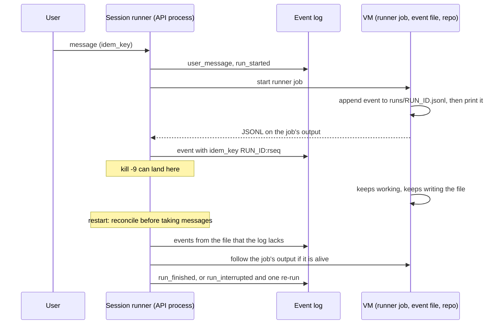

# Design notes

The decisions behind the lab, what each one costs, and where it would break. The README says what the lab does; this file says why it is built that way. Every number here is measured and recorded in [spike-results.md](spike-results.md) or in [the eval report](../evals/results/2026-11-17.md).

## The hardest state problem: one answer per message when the writer can die anywhere

A chat's truth is spread over three places that fail independently:

- the event log in PostgreSQL (durable, but only what was appended);
- the VM (the repo with the agent's edits, and for in-VM harnesses the runner's own event file `runs/<run_id>.jsonl`);
- the API process (the session runner, and for `deepagents_ollama` the whole agent loop).

A `kill -9` of the API can land between any two steps of a run. The question the lab has to answer after a restart is: for the last user message, has it been answered, is it still being answered, or must it be run again? Getting it wrong in one direction loses the message; in the other, the user gets two answers, and the agent may apply the same edit twice to a repo that already has it.

The rules that make it work:

1. **The log is the only truth; everything else is merged into it.** The VM's file and the job's output are sources, not state. Every durable event from the runner carries `idem_key = <run_id>:<rseq>`, and `UNIQUE (session_id, idem_key)` turns "append it again" into a no-op. That is what lets recovery read the file and then the job's output, which overlap, without counting anything twice.
2. **The runner writes the file before stdout.** An event the API saw is always in the file, so the file is a superset of what the API might have appended.
3. **The runner is a managed job, not a child of the API.** Measured: a process started with `exec_stream` dies at once when the host process that started it is SIGKILLed; an `exec_detached` job keeps running, and `follow_logs()` replays its output from the start. Without that, rule 2 protects nothing, because the agent dies with its reader.
4. **At most once beats at least once for answers.** A run that was interrupted is re-run once (`MAX_ATTEMPTS = 2`), and never if the log already holds an `agent_message` for it. A crash between the answer and `run_finished` therefore does not produce a second answer. The cost: when the API dies after a host-loop run answered but before `run_finished`, the run is closed as interrupted and not retried, so whatever that loop would still have appended (its usage, at least) is lost.
5. **Workspace snapshots bound what a lost VM costs.** After every run (failed runs too) the working tree is saved to the log as a binary patch against the starting commit (`workspace_saved`). A lost VM is rebuilt from the repo plus that patch. Edits made after the last snapshot are lost with the VM; edits made in a VM that survived are kept, and a re-run starts on them.
6. **The VM's lifecycle is in the log.** `sandbox_provisioning` is appended before a VM is created and `sandbox_attached` after its repo is in place, so a VM that was half set up when the API died is destroyed rather than reused without its code.

What is left open, on purpose:

- A re-run of an interrupted `deepagents_ollama` run gets the transcript (user and assistant messages), not the tool calls of the dead run. It sees their effects in the repo but has to rediscover them.
- A fork checks that the source is at its head and not running, then copies the VM. A run that starts on the source between the check and `fork()` is not guarded.
- Which failure orders matter was found by testing, not by reasoning alone. The Hypothesis test drives a model of the session runner against the real log and the real `reconcile` and `needs_run` over random interleavings of messages, agent steps, crashes and restarts. Mutation testing showed why the example count matters: one of the two seeded bugs went unnoticed with 400 random examples and was caught with 1000. Both cases are now pinned as explicit examples: an answer followed by a crash before `run_finished`, and an in-VM runner that wrote events while the API was down and then died.

Measured after a `kill -9`: the restarted API answers after 0.44 s, events the in-VM runner wrote while the API was down are in the log after 0.55 s, and reconciling a session takes 13 to 17 ms when no runner has to be followed.

## One writer per session

Only the session's runner task appends to its log. The database enforces the part it can:

- An append runs `pg_try_advisory_xact_lock(key)` on a key derived from the session uuid (its last 8 bytes, because the first 8 of a uuidv7 are mostly the timestamp). If another transaction holds it, the append raises `ConcurrentWriterError`.
- Under the lock the new `seq` is `max(seq) + 1`, so the log is gapless; the primary key `(session_id, seq)` is the last guard.
- User actions are idempotent: `INSERT ... ON CONFLICT (session_id, idem_key) DO NOTHING`, and on a conflict the existing `seq` is returned, so a retry of a message is recognised and not run twice.

| Option | What a second writer sees | Why not (or why) |
|---|---|---|
| Blocking lock (`pg_advisory_xact_lock`) | Waits, then succeeds | A bug (two runners for one session) becomes silent interleaving instead of an error |
| Optimistic concurrency (insert with the expected `seq`, fail on conflict) | Fails only when both pick the same `seq` | Works, but needs a read of the head before every write and a retry policy; the try-lock gives the same guarantee with one statement |
| Try-lock (chosen) | Fails at once with `ConcurrentWriterError` | Loud and cheap |

The limit, stated plainly: a transaction-scoped lock only catches writers whose transactions overlap. Two runners for one session in two processes could still append alternately without an error. The lab avoids that by running one API process (`make eval` and `make demo` start their own API and ask to stop `make api` first). With several API instances, ownership of a session would need a lease (a row with an owner and an expiry, or a session-level advisory lock held for the runner's lifetime), plus a **fencing token**: an epoch that increases with every new lease and that each append checks. The lease alone is not enough, because an old owner that was paused (GC, a stalled VM call) can wake up still believing it holds the lease; only a check at the write itself rejects it.

## Two harness placements and their crash cases

Every agent has a harness (the loop that decides the next step and calls tools) and a brain (the model). The lab runs each harness where its vendor designed it to run, and the session layer only sees the `Harness` interface: `placement`, `capabilities`, `vm_spec()` and an event stream.

| | A: loop on the host (`deepagents_ollama`) | B: agent in the VM (`claude_agent`, `claude_agent_local`) |
|---|---|---|
| Harness runs | In the API process, as an asyncio task | Inside the VM, as `runner.py` driving the Claude Agent SDK |
| VM role | Hands only: one `sb.exec` per tool call (0.7 ms p50 round trip) | Everything: harness, tools, repo |
| VM network | `Network.none()` | `api.deepseek.com` only, or no network plus one vsock port to a bridge that passes only `POST /v1/messages` to Ollama |
| Keys in the VM | None | None: the DeepSeek key is swapped in by microsandbox's host proxy for that one host |
| API crash | The loop dies; the VM and the log survive; the in-flight step is redone | The agent keeps working; its events are ingested from the file after the restart; nothing is lost |

A could match B's crash behaviour only by moving the loop into a separate worker process, which turns the API into a dispatcher with its own failure modes. For a host loop whose tools cost under a millisecond each, redoing one step is the cheaper trade.

## Why `claude_factory` allows subagents when `claude_agent` does not

`claude_agent` disables the `Agent` tool because a subagent's tool calls would hide inside one tool result, invisible to the event log and the tool-call cap. `claude_factory` exists to run slash-command prompts (research, plan, implement, validate) that are written around subagents, so it allows them and removes the reason they were banned: every message of a subagent reaches the runner too, so each of its tool calls becomes a durable `tool_call` with `parent` set to the `Agent` call it belongs to, and counts against the cap like the main agent's. In the spike's research run, 32 of 46 tool calls came from subagents.

Three settings make it safe and make it terminate:

- `setting_sources=[]`. With the SDK default (`None`) the CLI loads user, project and local settings, and project settings can define hooks, which run shell commands from the (untrusted) repo. No settings, hooks, `CLAUDE.md`, commands or agents are loaded from disk; the subagents are passed programmatically (`agents=`), parsed on the host from `LAB_FACTORY_AGENTS_DIR`. Only those agent files cross into the VM, never a personal `CLAUDE.md`, because everything in the VM is sent to DeepSeek.
- `CLAUDE_CODE_DISABLE_BACKGROUND_TASKS=1`. The CLI launched the subagents as background agents on its own (the model did not ask for it) and ended its turn with "agents are still running"; `receive_response()` stops at that first result, so the run finished without its document. With background tasks disabled, subagents run in the foreground and their answers come back as the `Agent` tool result.
- Every model alias (`haiku`, `sonnet`, `opus`) maps to the DeepSeek model, so agent files written for Claude work unchanged.

**Subagent usage comes from the CLI's transcripts.** Measured on a `research_codebase` run (4 subagent instances) by reading the CLI's own transcripts in the VM: the `ResultMessage` totals equal the main agent's transcript to the token (6 model calls, $0.0213) and leave out the subagents entirely (17 model calls, $0.0164 at the same prices); the per-turn `message_delta` stream events give the same number, so the reported cost was 56% of the true cost and the budget missed the subagents too. The subagents' own `AssistantMessage`s, which do reach the SDK, are no fix: summed per message id they still came to 75% of the true cost on the next run, because they carry `output_tokens: 0` (the streamed-usage gap listed in the README) and each subagent's last call, its answer, never arrives as a message. So for `claude_factory` the runner reads `~/.claude/projects/*/<session>/subagents/*.jsonl` inside the VM, incrementally (complete lines past the last read), keeps each model call once per message id (the CLI logs one line per content block), and adds those calls to `usage` and `cost_usd`, with `subagent_calls` and `subagent_cost_usd` reported separately. The budget check reads them too, whenever a subagent message arrives. After the fix, on a run with 18 subagent calls, `cost_usd` was $0.034879, equal to the main plus subagent transcripts to the last digit (subagents $0.018060, 52% of the run). The DeepSeek balance cannot check this at this scale (cent resolution against runs of a few cents). Remaining gap: the live budget check sees a subagent call only once its transcript line is written, so a run can overshoot `max_usd` by about one subagent call.

## Why state is a fold

Session, sandbox and run state are never stored. `state.fold(events)` derives them from the log through three explicit transition tables, and an event a machine does not allow in its current state raises `IllegalTransition`.

- There is one source of truth, so the state can never disagree with the history that produced it.
- Recovery is the same code as normal operation: fold the log, act on the result.
- Fork is a copy of a log prefix plus `forked_from`; the fork's state follows from the fold with no extra bookkeeping.
- Illegal transitions surface bugs at the event that caused them, not at some later read.

The cost is a read and a fold of the whole log per decision. With the 50-call cap a run adds about two events per tool call, so a chat's log stays small and the fold cheap; a long-lived chat would need snapshots of the folded state, keyed by `seq`.

## Why deltas are not persisted

Token-by-token `agent_delta` events go only through an in-process pub/sub to live subscribers; the durable `agent_message` replaces them. Storing them would multiply the log's size for text that the final message repeats, and every `pg_notify` would fire per token. Nothing depends on them after the fact: a reload or a second tab shows durable events, and recovery skips deltas because their moment has passed. The price is that a client that connects mid-answer sees the answer only when it is complete.

The live path itself: the append transaction calls `pg_notify('events', {session_id, seq})` (the address, never the event, because of the 8000-byte payload limit). One dedicated connection listens and wakes the session's subscribers, who read the rows after the last `seq` they have. A subscriber registers before its catch-up read and de-duplicates by `seq`, so an event that arrives during the catch-up is not lost or shown twice; after a listener reconnect every subscriber runs the catch-up again.

## Grader threat model

The agent is the adversary: it is rewarded for passing tests, so the grader must not be something it can reach.

- The agent never sees the hidden tests. Its VM gets a single-commit repo built from the task's `environment/` (no history, tags or remotes), and the API refuses the task directory itself.
- Only the final diff crosses over. It is rejected if it touches a hidden test path, any `conftest.py`, pytest or tox config, `sitecustomize.py`, `usercustomize.py`, a `*.pth` file, CI config or a lockfile, or if it holds a binary file, a symlink, a mode change or a path outside the repo.
- The diff is applied in a fresh VM with no network. The hidden tests are copied outside the repo and checked against their sha256; pytest runs with the grader's own config and root directory, without its cache and without plugin autoload, in isolated mode with the repo last on `sys.path`.
- Pass is a test result, never a model's opinion, and infrastructure errors are retried, not counted as failures.
- `make eval-check` attacks the grader before every eval: the reference passes, an empty diff fails, a hidden-test edit and a forcing `conftest.py` are rejected, a hardcoded diff fails, and zero collected tests fail.

What it does not stop: the agent's code is the code under test, so it runs inside the grader's pytest process and could, if written to attack the grader, forge the results. Transcript review (`lab replay`) is the control for that, and it found no reward hacking in the reviewed trials. A stronger design would run the tests in a separate process that reports through a channel the code under test cannot write to.

## Sandbox choice

| Option | Isolation | Runs on a Mac | Fork and snapshot | Why chosen or not |
|---|---|---|---|---|
| microsandbox (chosen) | One microVM per sandbox (libkrun on Hypervisor.framework) | Yes, natively | Copy-on-write fork of a running VM; disk snapshots | Python SDK with no daemon, network policies, host-scoped secrets and vsock in one library. Beta, and the VMs belong to the process that creates them, which is the recovery problem this lab is about |
| Apple `container` | One lightweight VM per container | Yes, macOS 26 and later | Not confirmed | The planned fallback. CLI only, no Python API, so fork would mean re-clone plus replay |
| Firecracker | microVM per sandbox, small device model | No: needs Linux with KVM | Memory and disk snapshots | The production standard for this shape of workload, and what the lab would move to on Linux hosts |
| gVisor | A user-space kernel that intercepts system calls | No: Linux only | Checkpoint and restore | Stronger than a container, weaker than a VM boundary, with syscall compatibility gaps |
| Docker | Shared kernel; on a Mac all containers share one Linux VM | Yes, through a VM | Commit an image; no live fork | Sessions would not be isolated from each other, so it is the last resort |

What microsandbox costs here, measured on this Mac: a warm create takes 194 ms (p50), a fork of a running VM 319 ms, and an idle VM about 115 to 126 MiB of host memory. Two limits shaped the design: `fork()` refuses a VM with a network policy of its own or with secrets, so forks of the real harnesses are rebuilt from the repo plus the saved workspace; and a non-detached VM dies with its owner, so every session VM is created detached and found again by name after a restart.
